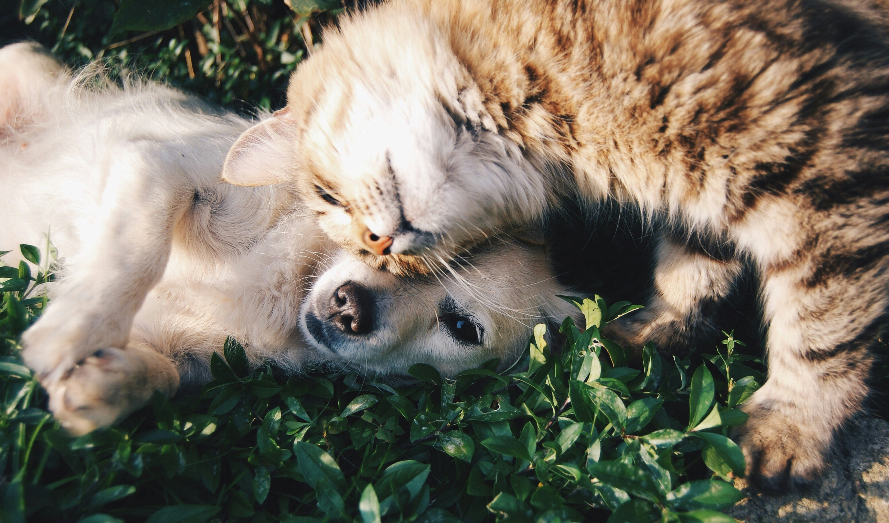

# Mood board: Tassula ry

## 1. Overall feeling

The three main words that describe the design of the Tassula website are:

- **Welcoming:** Visitors should feel comfortable exploring the website and learning about animals looking for homes.
- **Calm:** The design should be simple and organised, without too many colours or distracting elements.
- **Trustworthy:** Clear information and easy navigation should help visitors feel confident about contacting the shelter.

An animal shelter website should feel caring and friendly because its purpose is to help animals find safe, loving homes. The design should make it easy for visitors to find information about the animals, adoption and contacting Tassula.

## 2. Colour palette

The website uses three main colours:

| Colour | Hex code | Purpose |
|---|---|---|
| Dark spruce | `#12343b` | Main text, headings and navigation |
| Pale mint | `#eef6f4` | Main background and light sections |
| Orange | `#e8742a` | Decorative accents and highlights |

Dark spruce and pale mint create a contrast ratio of approximately **12:1**, which is higher than the WCAG AA requirement of 4.5:1 for normal text.

Orange is mainly used for decorative details and highlights. It is not used for small text on the pale mint background because that colour combination does not provide enough contrast.

In dark mode, the dark spruce and pale mint switch roles. This creates a darker background with light text while keeping the design consistent and readable.

## 3. Fonts and typography

The website uses two fonts:

- **Headings: Nunito.** Its rounded appearance gives the website a friendly and welcoming feeling.
- **Body text: Open Sans.** It is clear and easy to read, making it suitable for visitors of different ages.

Both fonts use a sans-serif fallback so the text remains readable if the preferred font is unavailable.

Clear heading sizes, readable body text and enough spacing help visitors understand the content without feeling overwhelmed.

## 4. Layout and accessibility

The layout is designed to be simple and easy to navigate.

- The website should work on small mobile screens as well as larger desktop screens.
- Images should resize to fit the available screen width.
- Navigation should be clear and consistent across all four pages.
- Links and form controls should have visible keyboard focus.
- Text and background colours should have sufficient contrast in both light and dark modes.
- Semantic HTML and descriptive image alternative text help visitors using screen readers.

Dark mode follows the visitor's device colour-scheme preference, so visitors do not need to change the website settings manually.

## 5. Design inspiration

I looked at these three animal welfare websites for inspiration:

1. [Onnentassu](https://www.onnentassu.fi/) – inspiration for presenting animals and adoption information.
2. [Pirkanmaan eläinsuojeluyhdistys (PESU)](https://pesu.org/) – inspiration for the information and structure of an animal welfare organisation's website.
3. [Kyproskissat ry](https://www.kyproskissat.fi/) – inspiration for presenting animals that need homes.

I use these websites as inspiration for ideas, but the Tassula website has its own simple and welcoming design.

## 6. Design goal

The goal is to create a friendly, accessible and trustworthy website that helps visitors learn about Tassula, discover animals looking for homes and find contact information easily. The colours, fonts and layout work together to create a calm experience on both mobile and desktop devices.